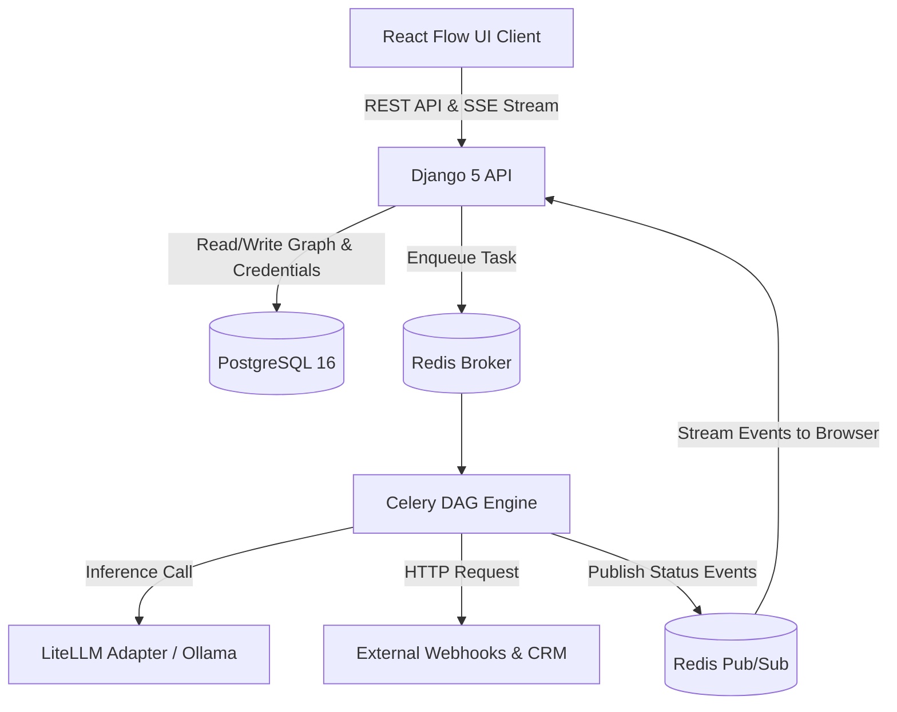

# FlowForge ⚡

**FlowForge** — это современная open-source платформа визуального проектирования, оркестрации и автоматизации AI-воркфлоу. Позволяет создавать сложные цепочки взаимодействий с большими языковыми моделями (LLM), внешними REST API, логическими ветвлениями и кастомными скриптами в интуитивном drag-and-drop интерфейсе.

---

## 🚀 Ключевые возможности

* **Визуальный редактор графов (React Flow v12):** Интерактивный холст с поддержкой зума, миникарты, Undo/Redo и автосохранения.
* **Кастомные типы узлов:**
  * `Trigger Node` (Webhook с генерацией URL и кнопкой копирования, Cron, Manual).
  * `LLM Node` (Единый AI-клиент: OpenAI GPT-4o, Claude 3.5, Google Gemini, DeepSeek, локальная Ollama).
  * `Condition Node` (Булево ветвление с типизированными выходами `true` и `false`).
  * `Action Node` (Исходящие HTTP POST / GET / PUT / DELETE запросы).
  * `Code Node` (Изолированная среда выполнения Python в безопасной песочнице).
* **Асинхронное ядро исполнения (Async DAG Engine):**
  * Обход графа на Celery + Redis с контролем циклов (Алгоритм Кана / Kahn's Algorithm).
  * Автоматическая пометка пропущенных веток статусом `SKIPPED`.
  * Безопасная интерполяция переменных `{{ nodes.node_id.output.field }}`.
* **Real-time мониторинг (Server-Sent Events):**
  * Подсветка статусов узлов (пульсирующий синий бордер при выполнении, зеленый при успехе, красный при ошибке).
  * Анимация соединительных линий в момент передачи данных.
  * Нижняя выдвижная консоль логов с просмотром входов и выходов каждого шага в формате JSON.
* **Шифрование пользовательских секретов:** Все API-ключи шифруются симметричным шифром Fernet в базе данных.
* **Production-ready Деплой:** Контейнеризация через Docker Compose и поддержка авторазвертывания в Coolify.

---

## 🛠 Технологический стек

| Слой | Технологии |
| :--- | :--- |
| **Frontend** | React 19, TypeScript, Vite, Tailwind CSS v4, `@xyflow/react`, Zustand, Lucide Icons |
| **Backend** | Python 3.12, Django 5, Celery 5, Redis 7, RestrictedPython, Cryptography, Pydantic, HTTPX |
| **База данных** | PostgreSQL 16 (JSONB, индексы GIN, Fernet crypto) / SQLite для тестов |
| **Инфраструктура** | Docker, Docker Compose, Nginx (с отключенной буферизацией SSE), Coolify |

---

## 📐 Архитектура системы



---

## 📦 Быстрый старт (Локальная разработка)

### Вариант 1: С использованием Docker Compose (Рекомендуется)

1. **Клонируйте репозиторий:**
   ```bash
   git clone https://github.com/your-username/flowforge.git
   cd flowforge
   ```

2. **Создайте файл переменных окружения:**
   ```bash
   cp .env.example .env
   ```

3. **Запустите контейнеры:**
   ```bash
   docker compose up --build -d
   ```

4. **Выполните миграции БД и инициализируйте демо-данные:**
   ```bash
   docker compose exec backend python manage.py migrate
   docker compose exec backend python manage.py seed_data
   ```

5. **Точки входа:**
   * **Frontend UI:** [http://localhost:5173](http://localhost:5173)
   * **Backend API & Health:** [http://localhost:8000/api/health/](http://localhost:8000/api/health/)
   * **Django Admin:** [http://localhost:8000/admin/](http://localhost:8000/admin/)

---

### Вариант 2: Запуск без Docker

#### Бэкенд
```bash
cd backend
python -m venv venv
# Windows:
venv\Scripts\activate
# Linux/macOS:
source venv/bin/activate

pip install -r requirements.txt
python manage.py migrate
python manage.py seed_data
python manage.py runserver
```

#### Фронтенд
```bash
cd frontend
npm install
npm run dev
```

---

## 🌐 Развертывание в Coolify

1. В панели Coolify выберите **New Resource** -> **Git Repository**.
2. Укажите ссылку на репозиторий `FlowForge` и ветку `main`.
3. Выберите Build Pack: **Docker Compose**.
4. Укажите путь к compose: `docker-compose.prod.yml`.
5. Заполните переменные окружения: `SECRET_KEY`, `POSTGRES_PASSWORD`, `REDIS_PASSWORD`.
6. Укажите FQDN домена (например `https://flowforge.yourdomain.com`).
7. Нажмите **Deploy**. Let's Encrypt SSL будет настроен автоматически.

---

## 📄 Лицензия
Проект распространяется под лицензией MIT.
